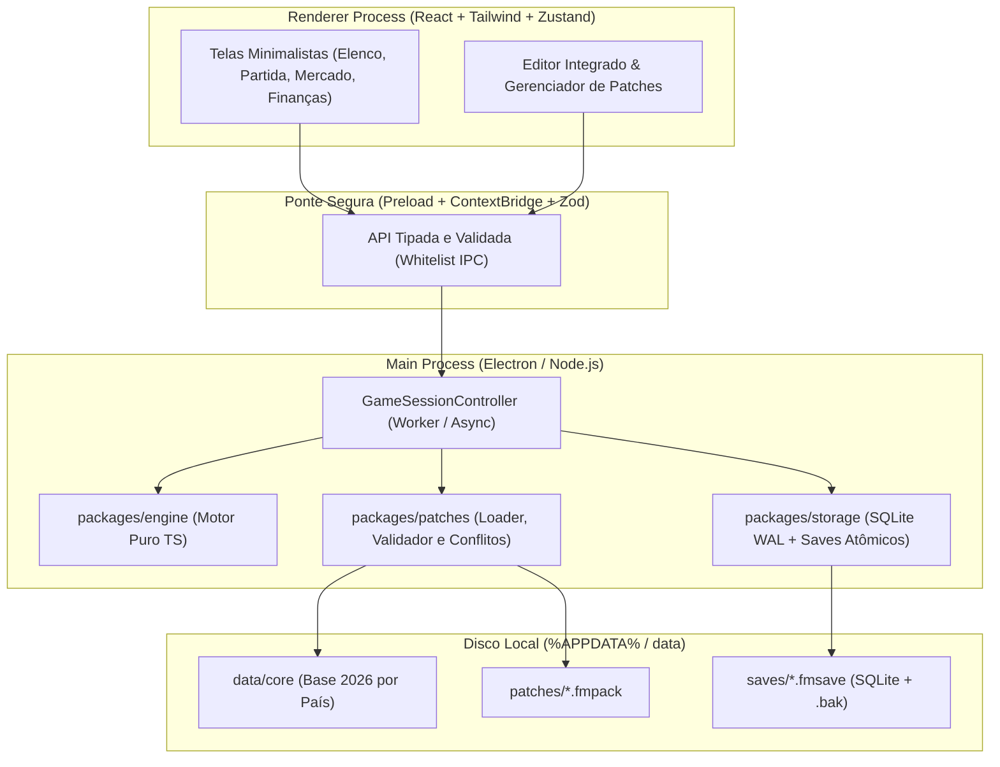

# Planejamento Completo & Especificação Técnica — Projeto FootManager (Nome a Definir)

> **Status do Documento:** Blueprint Aprovado para Implementação  
> **Data de Criação:** 22/11/2026  
> **Idioma Base:** Português-BR (`pt-BR`, com estrutura preparada para `i18n`)  
> **Plataforma Alvo (v1):** Instalável Desktop para PC (Windows `.exe`)  
> **Codinome de Trabalho:** `footmanager` *(substituir pelo nome oficial escolhido antes do empacotamento final)*

---

## 1. Visão Geral do Produto (Understanding Lock)

### 1.1 Propósito e Essência
Construir um **jogo de gerenciamento de futebol para PC (100% offline)**, com **marca própria**, inspirado na agilidade, simplicidade e ritmo viciante do *Brasfoot* clássico, mas concebido do zero com **arquitetura moderna, visual minimalista, competições no formato atual (2026), elencos/clubes/estádios reais atualizados** e um **sistema de patches extensível** capaz de adicionar novos países e campeonatos inteiros sem alterar o código-fonte.

### 1.2 Público-Alvo
* Jogadores que valorizam partidas e temporadas rápidas (1 temporada em ~20–30 minutos), telas diretas e zero burocracia pesada, mas desejam o futebol contemporâneo (novo Mundial de 32 clubes, nova Champions League de 36 clubes, Copa do Mundo de 48 seleções, 5 substituições, SAFs, mercado global moderno).
* Comunidade de criadores de patches/elencos que busca um **Editor Integrado** e importação de pacotes em 1 clique.

### 1.3 Pilares Inegociáveis do Produto
1. **Simplicidade e Velocidade:** avançar rodada com 1 clique; simulação global de todas as ligas em **menos de 1 segundo**.
2. **Visual Moderno e Minimalista:** interface limpa (claro/escuro), números tabulares alinhados e **cor de destaque dinâmica do clube treinado** (homenagem direta ao espírito do Brasfoot).
3. **Motor 100% Orientado a Dados (Data-Driven):** ligas, copas, regras, ciclos de temporada e patches são declarativos — nunca "chumbados" por país no código.
4. **Atualização Perpétua:** elencos, estádios e clubes reais (2026) vivem em arquivos externos/editáveis + importador automatizado + Editor Integrado.

### 1.4 Escopo Fechado (v1)
* **10 países / 15 divisões jogáveis** + Copas e Supercopas nacionais.
* **Estaduais no Brasil** em **modelo padrão unificado e opcional** (ligar/desligar na criação do save).
* **Competições Continentais de Clubes** (UEFA, CONMEBOL, AFC) + clubes complementares de IA para ligas não jogáveis.
* **Competições Mundiais de Clubes** (Copa Intercontinental anual + Mundial de Clubes de 32 clubes quadrienal).
* **Seleções Nacionais** (Eliminatórias, Copas Continentais e Copa do Mundo de 48 seleções), podendo treinar clube + seleção em paralelo.
* **Modo Carreira Single-Player** (começar em clube livre ou "por baixo" na menor divisão), com estrutura interna já pronta para **Hotseat Local na v2**.
* **Modernizações pontuais:** 5 substituições (banco de 12), janelas de transferência reais, SAF/investidores, pré-contrato, empréstimo com opção de compra, moral simples, auge longevo (declínio aos 33+ anos).
* **Editor Integrado + Gerenciador de Patches (`.fmpack`)** com resolução automática de conflitos.

### 1.5 Não-Objetivos Explícitos (Fora da v1)
* **Sem multiplayer online**, servidores, contas de usuário ou telemetria obrigatória.
* **Sem multiplayer local (Hotseat) na v1** *(reservado para v2; modelo de dados já suporta `humanManagers[]`)*.
* **Sem motor gráfico 3D ou campo 2D com movimentação de atletas** na v1 (simulação em placar/texto ao vivo + barras de posse/pressão).
* **Sem microgerenciamento estilo Football Manager** (coletivas de imprensa, treinos diários complexos, instruções individuais por jogador, comissão técnica extensa).
* **Sem 27 regulamentos estaduais diferentes no Brasil**.
* **Sem versão mobile na v1** (foco exclusivo em instalável Windows; arquitetura facilita porte futuro).

### 1.6 Sugestões de Nome Próprio (para escolha futura)
* **Prancheta 26 / Prancheta FC** — identidade brasileira forte e direta ao papel de técnico.
* **Tática Livre / Tática Total** — remete à essência tática e rápida.
* **Beira do Campo** — marcante, original e futebolístico.
* **GolManager / FutPrancheta** — objetivo e fácil de lembrar.
* **Bancada FC / Vestiário FC** — moderno e minimalista.

---

## 2. Decision Log (Registro de Decisões Arquiteturais e de Produto)

| ID | Tópico | Decisão Adotada | Alternativas Consideradas | Justificativa |
| :--- | :--- | :--- | :--- | :--- |
| `DEC-001` | Stack Desktop | **TypeScript + React (Vite/Tailwind) + Electron + SQLite** | Tauri v2 (Rust); C#/.NET + Avalonia UI | Uma única linguagem (TS) para motor, UI, scripts e testes; zero atrito no ambiente local (`Node.js` já instalado); máxima agilidade para UI minimalista e reuso futuro (web/mobile). |
| `DEC-002` | Base de Dados Inicial | **Nomes reais de clubes, jogadores e estádios (2026)**, desacoplados em arquivos externos | Base fictícia desde o dia 1; dados hardcoded no código | Atende diretamente à visão do criador e mantém arquitetura limpa para atualizações rápidas ou eventual troca de pack oficial antes de publicação em lojas. |
| `DEC-003` | Ligas Jogáveis | **10 países / 15 divisões** (inclui 1ª div. da Alemanha) | 9 países sem Alemanha | A Bundesliga tem peso central na Champions League e no mercado europeu; eleva drasticamente a imersão global. |
| `DEC-004` | Estaduais no Brasil | **Modelo padrão unificado (~10 datas), opcional ao criar save** | 27 formatos reais; remover estaduais | Regulamentos estaduais mudam anualmente; modelo padrão traz a nostalgia clássica sem inchar o banco nem engessar o calendário. |
| `DEC-005` | Ligas de 1 Divisão | **Pool de Acesso (6–8 clubes reais da 2ª div. em background)** | Sem rebaixamento; simular 2ª divisão inteira | Mantém ligas como Bundesliga, Ligue 1, Portugal, Arábia Saudita, Japão e Argentina vivas com acesso/descenso sem explodir o escopo da base. |
| `DEC-006` | Profundidade vs. Ritmo | **Ritmo rápido Brasfoot + modernizações pontuais** | Clonagem pura anos 2000; simulação profunda estilo FM | Preserva a diversão imediata (temporada rápida) trazendo o futebol real de 2026 (5 subs, SAF, janelas, pré-contrato, empréstimo c/ opção). |
| `DEC-007` | Multiplayer | **Single-player na v1; Hotseat guardado para v2** | Hotseat na v1; Multiplayer Online | Aplica YAGNI na v1 eliminando complexidade de troca de turnos na UI, mantendo `humanManagers[]` no schema para ativar Hotseat facilmente depois. |
| `DEC-008` | Longevidade de Atletas | **Auge 24–32 anos (goleiros 25–35); declínio a partir dos 33+ (goleiros 36+)** | Declínio aos 30–31 anos | Reflete a preparação física e longevidade real do futebol atual. |
| `DEC-009` | Sistema de Patches | **`.fmpack` declarativo (JSON + imagens, zero código executável)** com Templates de Competição | Scripts JS em plugins; edição direta no banco | Permite adicionar países/ligas inteiras (ex.: EUA/MLS) com segurança total (sem XSS/malware) e sem alterar código do motor. |
| `DEC-010` | Conflitos de Patches | **3 camadas:** Load Order (merge parcial) + deduplicação de jogador por ID canônico + bloqueio estrutural | Último arquivo sobrescreve tudo | Resolve o problema clássico de jogadores duplicados entre patches de países diferentes mantendo transparência ao usuário. |
| `DEC-011` | Persistência & Saves | **SQLite (`better-sqlite3`) com snapshot da base ativa + gravação atômica + backup `.bak`** | JSON puro em disco; IndexedDB | Desempenho superior em consultas/históricos de múltiplas temporadas, proteção contra corrupção e total independência após desinstalar patches. |
| `DEC-012` | Internacionalização | **Português-BR na v1 com `i18next` configurado desde a Fase 0** | Strings fixas em português | Custo quase zero no início e abre caminho direto para distribuição internacional (inglês/espanhol) depois. |

---

## 3. Requisitos Não-Funcionais, Escala e Nota Jurídica

### 3.1 Requisitos Não-Funcionais (Targets Obrigatórios)
* **Performance de Simulação:** simular 1 semana/rodada global completa (15 divisões + copas + continentais/seleções ativas) em **< 1.000 ms** (meta ideal: `< 300 ms`), executando fora da thread de renderização (Worker ou processo principal Node do Electron) para jamais travar a UI.
* **Leveza:** inicialização do app em `< 3 segundos`; consumo estável de RAM; listas grandes (mercado com milhares de jogadores) sempre **virtualizadas** (`@tanstack/react-virtual`).
* **Escala Esperada (Base Completa v1):**
  * ~350 clubes jogáveis nas 15 divisões + ~45 clubes em Pools de Acesso + ~80 clubes complementares de IA (Europa/América do Sul/Ásia/CONCACAF/CAF/OFC) + ~64 seleções.
  * Estimativa de **9.000 a 12.000 jogadores** na base completa.
* **Confiabilidade:** 100% offline; múltiplos slots de save; auto-save configurável; escrita atômica com backup do estado anterior (`save.db` + `save.db.bak`); motor com PRNG com *seed* opcional para reprodução determinística de bugs.
* **Manutenibilidade:** TypeScript em `strict: true`, funções pequenas e reutilizáveis, **comentários em português-BR** explicando regras de negócio e fórmulas, e atualização obrigatória da documentação a cada nova funcionalidade.

### 3.2 Nota sobre Distribuição Pública e Propriedade Intelectual
Como há intenção de distribuir o jogo publicamente em alguns meses:
* O código-fonte, nome, identidade visual, escudos genéricos padrão e documentação são **100% originais**.
* O uso de nomes reais de clubes, jogadores, ligas e escudos diretamente em um instalador comercial ou publicado em lojas oficiais (Steam, Epic, etc.) pode sofrer restrições de marcas/FIFPRO.
* **Mitigação arquitetural já embutida:** toda a base real (2026) reside em `data/core/` no mesmo formato de **Pack**. Caso seja necessário no momento da publicação em loja, basta distribuir o instalador com um pack oficial de nomes adaptados/livres e disponibilizar a base real separadamente como `.fmpack` importável em 1 clique — **sem alterar uma única linha do motor**.

---

## 4. Arquitetura Técnica e Estrutura de Diretórios

### 4.1 Stack Tecnológica Recomendada
| Camada | Tecnologia | Motivo |
| :--- | :--- | :--- |
| **Linguagem** | TypeScript 5.x (`strict: true`) | Tipagem forte ponta a ponta, menos bugs em regras complexas de calendário e mercado. |
| **Desktop Shell** | Electron 33+ & `electron-builder` | Instalador NSIS/Windows (`.exe`) estável, acesso nativo a SQLite e sistema de arquivos. |
| **Frontend UI** | React 19 (ou 18.3) + Vite + Tailwind CSS v4 | UI minimalista rápida, temas dinâmicos por CSS Variables (`--club-primary`, `--club-secondary`). |
| **Estado UI** | Zustand | Estado simples, leve e sem boilerplate excessivo. |
| **Validação** | Zod | Validação estrita de schemas de patches `.fmpack`, mensagens IPC e formulários do Editor. |
| **Persistência** | `better-sqlite3` (WAL mode) | Velocidade nativa em C++, consultas SQL seguras com *prepared statements*, transações atômicas. |
| **Listas Grandes** | `@tanstack/react-virtual` | Renderização instantânea de listas com 10.000+ jogadores no Mercado e no Editor. |
| **Áudio** | Web Audio API + arquivos `.ogg/.wav` curtos | Efeitos clássicos leves (apito, gol, cartão, clique) com controle de volume e mudo. |
| **i18n** | `i18next` + `react-i18next` | Base em `pt-BR`, pronta para tradução futura sem refatoração. |
| **Testes** | Vitest + Testing Library | Testes unitários do motor, testes de conflitos de patches e simulação de estresse de 10 temporadas. |
| **Ícones / Fonte** | `lucide-react` + `Inter` & `JetBrains Mono` | Visual limpo com números tabulares (`tabular-nums`) para placares e tabelas. |

### 4.2 Diagrama de Arquitetura em Camadas



### 4.3 Estrutura Completa de Diretórios (Onde Cada Código Deve Ser Criado)

Criar o projeto em uma pasta dedicada e limpa (ex.: `C:\Users\Ismael\Documents\antigravity\<nome-do-jogo>\` ou subpasta isolada):

```text
<nome-do-jogo>/
├── docs/                                # Documentação viva (atualizar a cada feature!)
│   ├── ARQUITETURA.md
│   ├── REGRAS_COMPETICOES.md
│   ├── MOTOR_SIMULACAO.md
│   ├── FORMATO_FMPACK.md
│   └── CHANGELOG.md
├── packages/
│   ├── schemas/                         # Contratos Zod & Tipos TS compartilhados
│   │   └── src/
│   │       ├── country.schema.ts        # País, confederação, ciclo, janelas
│   │       ├── competition.schema.ts    # Templates declarativos de competições
│   │       ├── club.schema.ts           # Clube, estádio, finanças, gestão SAF
│   │       ├── player.schema.ts         # Jogador, atributos, traits, contrato
│   │       ├── match.schema.ts          # Estado da partida, eventos, estatísticas
│   │       ├── patch.schema.ts          # Manifesto .fmpack e regras de conflito
│   │       ├── save.schema.ts           # Snapshot de carreira e estado do mundo
│   │       └── ipc.schema.ts            # Payloads validados de comunicação IPC
│   ├── engine/                          # Motor de simulação 100% puro (sem Electron/React)
│   │   └── src/
│   │       ├── rng/                     # PRNG determinístico (Mulberry32)
│   │       ├── match/                   # Cálculo por setores, loop minuto-a-minuto, batch sim
│   │       ├── tactics/                 # Formações, matriz tática, penalidades fora de posição
│   │       ├── calendar/                # Motor de 52 semanas, reagendamentos, Datas FIFA
│   │       ├── competitions/            # Executores de cada template (Suíço 36, Liga, Copas, etc.)
│   │       ├── world/                   # Intercontinental, Mundial 32, Copa do Mundo 48, Ranking
│   │       ├── transfers/               # Janelas, negociações, pré-contrato, empréstimo c/ opção, IA
│   │       ├── finance/                 # Bilheteria, TV, patrocínio, estádio, empréstimo, SAF
│   │       ├── progression/             # Evolução (16-23), auge (24-32), declínio (33+), base juniores
│   │       ├── career/                  # Confiança da diretoria, demissão, propostas, seleções
│   │       └── orchestrator.ts          # Controlador de avanço semanal (tick da temporada)
│   ├── patches/                         # Sistema de Patches (.fmpack)
│   │   └── src/
│   │       ├── unpacker.ts              # Leitura segura de ZIP (anti path-traversal + limites)
│   │       ├── sanitizer.ts             # Sanitização de SVG, imagens e strings
│   │       ├── validator.ts             # Validação Zod + integridade (elencos, datas, IDs)
│   │       ├── conflictResolver.ts      # Resolução em 3 camadas (Load Order + Deduplicação)
│   │       └── composer.ts              # Compila Base Oficial + Patches Ativos -> WorldSnapshot
│   └── storage/                         # Persistência SQLite & Snapshots
│       └── src/
│           ├── sqliteClient.ts          # Conexão better-sqlite3 em WAL + prepared statements
│           ├── migrations/              # Scripts SQL versionados do banco de save
│           ├── saveRepository.ts        # Gravação atômica, rotação .bak, import/export
│           └── historyRepository.ts     # Consultas rápidas de artilheiros, títulos e ranking
├── apps/
│   └── desktop/                         # Aplicação Electron + React + Tailwind
│       ├── electron/
│       │   ├── main.ts                  # Janela principal endurecida (sandbox/contextIsolation)
│       │   ├── preload.ts               # ContextBridge expondo apenas métodos da whitelist
│       │   ├── ipcHandlers.ts           # Handlers validando entrada via Zod antes de chamar engine
│       │   └── simulationWorker.ts      # Worker Thread para simular rodadas sem travar a UI
│       ├── src/
│       │   ├── app/                     # Rotas, layout principal, tema dinâmico do clube
│       │   ├── store/                   # Stores Zustand (carreira, partida ao vivo, filtros UI)
│       │   ├── i18n/                    # Traduções (pt-BR.json)
│       │   ├── audio/                   # Gerenciador Web Audio API (apito, gol, clique)
│       │   ├── components/              # Componentes reutilizáveis minimalistas (Tabela, Badge, Card)
│       │   └── features/
│       │       ├── menu/                # Tela inicial, Novo Jogo, Carregar Save
│       │       ├── squad/               # Elenco, escalação, formação e tática rápida
│       │       ├── matchday/            # Partida ao vivo (placar, narração, barras, 5 subs)
│       │       ├── competitions/        # Tabelas, chaves mata-mata, artilharia, calendário
│       │       ├── transfers/           # Mercado virtualizado, olheiro, propostas, empréstimos
│       │       ├── finance/             # Caixa, estádio, ingresso, empréstimo, status SAF
│       │       ├── youth/               # Categoria de base (juniores)
│       │       ├── national/            # Seleções, convocação, Copa do Mundo e Continentais
│       │       ├── history/             # Galeria de troféus, ranking de técnicos, recordes
│       │       ├── editor/              # Editor Integrado (exporta/importa .fmpack)
│       │       └── patches/             # Gerenciador de Patches (Load Order + alertas conflito)
│       └── electron-builder.yml         # Configuração do instalador Windows (.exe NSIS)
├── data/
│   └── core/                            # Base Real 2026 modular (mesmo formato de Pack)
│       ├── manifest.json
│       ├── countries/
│       │   ├── bra/                     # country, competitions, clubs, stadiums, players, states
│       │   ├── eng/                     # 2 divisões + FA Cup + Supercopa
│       │   ├── esp/                     # 2 divisões + Copa del Rey + Supercopa
│       │   ├── ita/                     # 2 divisões + Coppa Italia + Supercoppa
│       │   ├── deu/                     # 1 divisão + DFB-Pokal + Supercopa + access_pool
│       │   ├── fra/                     # 1 divisão + Coupe de France + Supercopa + access_pool
│       │   ├── por/                     # 1 divisão + Taça de Portugal + Supertaça + access_pool
│       │   ├── arg/                     # 1 divisão + Copa Argentina + access_pool
│       │   ├── sau/                     # 1 divisão + King's Cup + Super Cup + access_pool
│       │   └── jpn/                     # 1 divisão + Emperor's Cup + access_pool
│       └── international/               # Seleções, clubes IA complementares, Continentais e Mundiais
├── tools/
│   └── importer/                        # CLI em TS para importar/atualizar elencos 2026 via CSV/API
│       └── src/
│           ├── normalize.ts             # Normalização de nomes, posições e IDs canônicos
│           ├── ratingCalculator.ts      # Fórmula de força (1-99), estrela e salário inicial
│           └── validateCoreData.ts      # Auditoria automática da base completa antes do build
├── tests/
│   ├── unit/                            # Fórmulas de simulação, idade, finanças, desempates
│   ├── integration/                     # Patches, resolução de conflitos, persistência SQLite
│   └── stress/                          # Simulação automática de 10 temporadas consecutivas
└── package.json                         # Workspaces npm + scripts globais
```

---

## 5. Catálogo de Competições e Calendário Global (52 Semanas)

### 5.1 Países e Divisões Jogáveis (10 Países / 15 Divisões)

| País | Confed. | Ciclo | Divisões Jogáveis | Clubes/Div. | Rebaixamento / Acesso | Copas Nacionais |
| :--- | :--- | :--- | :--- | :--- | :--- | :--- |
| **Brasil (`BRA`)** | CONMEBOL | Ano Civil | Série A, B, C, D + Estaduais *(opc.)* | 20 / 20 / 20 / 64 | 4 sobem / 4 caem (D usa pool estadual p/ 16 vagas ou base rotativa) | Copa do Brasil + Supercopa Rei |
| **Inglaterra (`ENG`)** | UEFA | Dividido | Premier League, Championship | 20 / 24 | 3 caem / 2 sobem + 1 via playoff (3º–6º); 3 caem da D2 para pool | FA Cup + Community Shield |
| **Espanha (`ESP`)** | UEFA | Dividido | La Liga, Segunda División | 20 / 22 | 3 caem / 2 sobem + 1 via playoff (3º–6º); 4 caem da D2 para pool | Copa del Rey + Supercopa |
| **Itália (`ITA`)** | UEFA | Dividido | Serie A, Serie B | 20 / 20 | 3 caem / 2 sobem + 1 via playoff; 4 caem da D2 para pool | Coppa Italia + Supercoppa |
| **Alemanha (`DEU`)** | UEFA | Dividido | Bundesliga | 18 | 2 caem direto + 16º joga playoff contra líder do **Pool de Acesso** | DFB-Pokal + Supercup |
| **França (`FRA`)** | UEFA | Dividido | Ligue 1 | 18 | 2 caem direto + 16º playoff contra **Pool de Acesso** | Coupe de France + Trophée des Champions |
| **Portugal (`POR`)** | UEFA | Dividido | Primeira Liga | 18 | 2 caem direto + 16º playoff contra **Pool de Acesso** | Taça de Portugal + Supertaça |
| **Argentina (`ARG`)** | CONMEBOL | Ano Civil | Liga Profesional | 28 *(ou 20/28 conf. 2026)* | 2 caem para **Pool de Acesso** (por classificação anual) | Copa Argentina + Trofeo de Campeones |
| **Arábia Saudita (`SAU`)** | AFC | Dividido | Saudi Pro League | 18 | 3 caem para **Pool de Acesso** | King's Cup + Saudi Super Cup |
| **Japão (`JPN`)** | AFC | Ano Civil | J1 League | 20 | 3 caem para **Pool de Acesso** | Emperor's Cup + Super Cup |

#### Regra de Rebaixamento nas Ligas de 1 Divisão (Pool de Acesso)
* Cada país com 1 divisão (`DEU`, `FRA`, `POR`, `ARG`, `SAU`, `JPN`) e a última divisão jogável dos países com 2 divisões (`ENG D2`, `ESP D2`, `ITA D2`) possuem um **Pool de Acesso** com **6 a 8 clubes reais da divisão imediatamente inferior** (com elencos e estádios reais).
* Ao fim da temporada, o motor simula uma mini-tabela rápida entre os clubes do pool para definir quem sobe. Os clubes rebaixados entram no pool (mantendo seus elencos/finanças) e podem retornar na temporada seguinte.
* Se o técnico humano for rebaixado para fora das divisões jogáveis, a diretoria encerra o vínculo e o técnico recebe propostas de clubes das divisões jogáveis disponíveis.

### 5.2 Estaduais no Brasil — Modelo Padrão Unificado (Opcional)
* **Configuração ao criar o save:** toggle `"Incluir Campeonatos Estaduais (Brasil)"` (padrão: **Ativado**).
* **Abrangência:** 10 Estaduais individuais (**SP, RJ, MG, RS, PR, BA, CE, PE, GO, SC**) + **1 torneio "Copa Demais Estados"** (agrupando os clubes das Séries A–D dos demais estados, fiel à lógica enxuta do Brasfoot clássico).
* **Formato Padrão Único (~10 datas, Semanas 3 a 12):**
  * **8 ou 12 clubes** por campeonato (usando os clubes do estado nas Séries A–D + clubes estaduais complementares apenas onde faltar para completar 8).
  * Fase única de pontos corridos em turno único (7 datas para 8 clubes; ou 2 grupos de 6 com 5–6 datas para 12 clubes) → **Semifinal (jogo único)** → **Final (ida e volta ou jogo único)**.
* **Benefícios esportivos:** troféu oficial na galeria, premiação financeira de início de ano, ritmo/evolução de juniores e classificação dos melhores sem divisão nacional para vagas rotativas na Série D.

### 5.3 Formatos das Séries C e D do Brasil
* **Série C (20 clubes):** 19 rodadas em turno único → Top 8 divididos em 2 quadrangulares (6 rodadas) → 2 primeiros de cada quadrangular sobem à Série B; líderes decidem o título em ida e volta; 4 últimos da 1ª fase caem à Série D.
* **Série D (64 clubes):** 8 grupos regionalizados de 8 clubes (14 rodadas ida e volta) → Top 4 de cada grupo avançam ao mata-mata (16-avos, oitavas, quartas, semis e final em ida e volta) → 4 semifinalistas sobem à Série C.

### 5.4 Competições Continentais de Clubes (Formatos 2026)
1. **UEFA Champions League / Europa League / Conference League (Novo Formato Liga — 36 Clubes):**
   * **Fase de Liga:** 36 clubes em tabela única; cada clube faz **8 jogos** (4 casa, 4 fora — 2 contra cada um dos 4 potes; na Conference são 6 jogos).
   * **Classificação:** `1º–8º` avançam direto às Oitavas; `9º–24º` disputam Playoffs (ida e volta); `25º–36º` eliminados (sem rebaixamento de torneio, conforme regra 2024+).
   * **Preenchimento das 36 vagas:** clubes classificados das 6 ligas europeias jogáveis (`ENG, ESP, ITA, DEU, FRA, POR`) + **clubes reais complementares de IA** (Holanda, Bélgica, Escócia, Turquia, Áustria, Suíça, Grécia, Ucrânia, Rep. Tcheca, Dinamarca, Noruega, Croácia, Sérvia) com força realista e elencos reais simplificados.
   * **Supercopa da UEFA:** Campeão Champions vs. Campeão Europa League (jogo único, início da temporada europeia).
2. **CONMEBOL Libertadores & Sul-Americana:**
   * **Libertadores (32 clubes):** 8 grupos de 4 (6 rodadas) → 2 primeiros vão às Oitavas (ida e volta) → Final em jogo único. Vagas de Brasil e Argentina + clubes reais complementares de IA (Uruguai, Colômbia, Equador, Chile, Paraguai, Peru, Bolívia, Venezuela).
   * **Sul-Americana (32 clubes):** 8 grupos de 4 → 1º de cada grupo vai direto às Oitavas; **2º de cada grupo enfrenta o 3º de cada grupo da Libertadores em Playoffs (ida e volta)** → Oitavas até Final única.
   * **Recopa Sul-Americana:** Campeão Libertadores vs. Campeão Sul-Americana (ida e volta).
3. **AFC Champions League Elite (24 clubes — Ásia):**
   * **Zona Oeste (12 clubes):** classificados da **Arábia Saudita** + clubes reais de IA (Catar, EAU, Irã, Uzbequistão, Iraque).
   * **Zona Leste (12 clubes):** classificados do **Japão** + clubes reais de IA (Coreia do Sul, Austrália, China, Tailândia, Malásia).
   * Fase de Liga (8 jogos por zona) → Top 8 de cada zona vão ao mata-mata → Fase final reunindo Oeste vs. Leste até o campeão asiático.
4. **Outras Confederações (CONCACAF, CAF, OFC):**
   * Simuladas em segundo plano usando clubes reais de referência (ex.: México/EUA, Egito/Marrocos/África do Sul, Nova Zelândia) para alimentar Intercontinental e Mundial de 32 — **automaticamente substituídas por clubes jogáveis caso o usuário instale um patch** daquela confederação (como EUA/MLS ou Liga MX).

### 5.5 Competições Mundiais de Clubes
1. **Copa Intercontinental da FIFA (Anual — Dezembro, Semanas 49–50):**
   * Chave eliminatória entre campeões da AFC, CAF, OFC, CONCACAF e CONMEBOL; o campeão da UEFA entra diretamente na grande final.
2. **Mundial de Clubes da FIFA (32 Clubes — Quadrienal: 2029, 2033... — Semanas 24–28):**
   * **Distribuição de vagas:** UEFA (12), CONMEBOL (6), CONCACAF (4), CAF (4), AFC (4), OFC (1), País-sede (1).
   * **Critério:** campeões continentais das últimas 4 temporadas + complemento pelo **Ranking Quadrienal de Clubes da Confederação** (calculado automaticamente pelo motor com pontos por vitórias/fases continentais; máximo de 2 clubes por país, exceto se mais clubes daquele país forem campeões continentais).
   * **Formato:** 8 grupos de 4 (3 jogos) → 2 primeiros avançam → Oitavas, Quartas, Semi e Final em jogo único.

### 5.6 Seleções Nacionais (Ciclo de 4 Anos)
* **Datas FIFA fixas:** 5 janelas por ano no calendário de 52 semanas (Março, Junho, Setembro, Outubro, Novembro).
* **Eliminatórias:** disputadas nas Datas FIFA nos 3 anos anteriores à Copa.
* **Copas Continentais (anos pares sem Copa do Mundo — 2028, 2032... — Semanas 24–28):** Eurocopa (24 seleções), Copa América (16), Copa da Ásia (24), CAN (24), Copa Ouro (16).
* **Copa do Mundo da FIFA (48 Seleções — 2026, 2030, 2034... — Semanas 23–28):**
  * 12 grupos de 4 seleções (turno único).
  * Avançam os **2 primeiros de cada grupo (24) + os 8 melhores terceiros colocados** = **32 seleções**.
  * Mata-mata em jogo único: **16-avos → Oitavas → Quartas → Semifinais → 3º Lugar → Final**.
* **Convocação:** se o técnico humano também treinar uma seleção, convoca 26 atletas antes de cada Data FIFA/torneio; se treinar apenas clube, atletas convocados desfalcam o clube apenas se houver jogo em conflito naquela semana (ligas principais pausam em Datas FIFA).

### 5.7 Mapa do Calendário Global de 52 Semanas (Convivência dos 2 Ciclos)

| Período | Semanas | Ciclo Ano Civil (`BRA, ARG, JPN` + futuro `USA`) | Ciclo Dividido (`ENG, ESP, ITA, DEU, FRA, POR, SAU`) | Internacional / Seleções |
| :--- | :---: | :--- | :--- | :--- |
| **Jan** | 1–4 | Pré-temporada + Janela 1 + Início Estaduais | 2º Turno Ligas + Copas + Janela de Inverno (S1–S4) | Rodadas finais Fase de Liga UEFA/AFC |
| **Fev–Mar** | 5–13 | Estaduais (finais S12) + Início Copa do Brasil + Grupos Liberta/Sula | Ligas + Oitavas UEFA/AFC + Copas Nacionais | **Data FIFA 1 (S12)** |
| **Abr–Mai** | 14–21 | Início Brasileirão (A–D), Argentina, J1 + Grupos Liberta/Sula | Reta final Ligas + Quartas/Semis/Finais UEFA/AFC + Finais Copas → **Fim de Temporada Dividida (S21)** | — |
| **Jun–Jul** | 22–30 | Pausa/ritmo reduzido em anos de Copa/Mundial + Janela 2 (S28–S32) | Férias + **Virada de Temporada Dividida (S26)** + **Janela de Verão (S27–S35)** | **Data FIFA 2 (S23)** + **Copa do Mundo (48) / Mundial de Clubes (32) / Copas Continentais (S24–S28)** |
| **Ago–Set** | 31–39 | Meio do Brasileirão/ARG/JPN + Oitavas/Quartas Liberta/Sula | Supercopas + **Início das Ligas Divididas (S32–S33)** + Início Fase Liga UEFA/AFC | **Data FIFA 3 (S36)** |
| **Out–Nov** | 40–47 | Reta final Ligas + Finais Copa do Brasil + Finais Liberta/Sula | Fase regular Ligas + Fase de Liga UEFA/AFC + Copas | **Data FIFA 4 (S41)** + **Data FIFA 5 (S46)** |
| **Dez** | 48–52 | Encerramento Ligas (S48) → **Virada de Temporada Ano Civil (S51)** | Rodadas de inverno (Boxing Day na Inglaterra!) | **Copa Intercontinental FIFA (S49–S50)** |

> **Regra de Ouro para Virada Assíncrona:** Envelhecimento de atletas, expiração de contratos europeus (30/junho = Semana 26) vs. sul-americanos/asiáticos (31/dezembro = Semana 51), premiações e acessos/rebaixamentos disparam **no evento de encerramento do ciclo de cada país**, enquanto a idade dos jogadores avança exatamente na sua semana de aniversário (evitando saltos artificiais!).

---

## 6. Motor de Simulação, Táticas, Finanças/SAF e Mercado

### 6.1 Modelo de Jogador e Curva de Longevidade
* **Atributos principais:**
  * `id` (string canônica), `name`, `nationality`, `birthDate`, `age`
  * `primaryPosition`: `GOL | ZAG | LAT | VOL | MEI | ATA`
  * `secondaryPosition`: opcional (sem penalidade quando escalado nela)
  * `overall`: `1–99` (Força Geral)
  * `isStar`: `boolean` (Estrela `★` — garante bônus em momentos decisivos, bola parada e maior valor comercial)
  * `traits`: array de **0 a 2 Características Especiais**:
    * *Linha:* `FINALIZACAO`, `ARMACAO`, `PASSE`, `DRIBLE`, `VELOCIDADE`, `CABECEIO`, `DESARME`, `MARCACAO`, `RESISTENCIA`, `BOLA_PARADA`
    * *Goleiro:* `REFLEXO`, `SAIDA_GOL`, `PENALTIS`
  * `energy`: `0–100` (desgaste na partida + recuperação entre semanas)
  * `morale`: `1–5` (`1=Péssima`, `2=Baixa`, `3=Normal`, `4=Boa`, `5=Excelente`)
  * `injuryWeeks`: `0..N`, `yellowCardsAccumulated`, `suspensionMatches`
* **Curva de Evolução por Idade (Conforme `DEC-008`):**
  * **16–23 anos (Evolução):** ganha `+1` a `+4` de força por temporada dependendo de minutos jogados, moral, estrutura do clube e potencial oculto (`potential`, teto `<= 99`).
  * **24–32 anos (Auge Longevo — Goleiros 25–35):** estabilidade total, com pequenas oscilações (`-1` a `+2`) ligadas à fase/desempenho na temporada.
  * **33+ anos (Declínio Gradual — Goleiros 36+):** queda suave (`-1` a `-3`/ano), atenuada em 35% se o atleta tiver `RESISTENCIA` ou `isStar = true`. Probabilidade crescente de aposentadoria a partir dos 35 anos (goleiros 38+).

### 6.2 Fórmulas do Motor de Partida (`packages/engine/src/match/`)
Para garantir resultados realistas, rápidos e balanceados (média global de ~2,55 gols/jogo):

1. **Força Efetiva de cada Titular (`eff`):**
   ```text
   eff = overall
         × fatorEnergia(energy)          // 1.00 (>=80%) até 0.72 (<30%)
         × fatorMoral(morale)            // 0.94 (Péssima) a 1.06 (Excelente)
         × fatorPosicao(pos, slot)       // 1.00 (primária), 0.97 (secundária), 0.75 (improvisado)
         + bonusEstrela(isStar ? +2.5 : 0)
   ```
2. **Força por Setor (0–100+):**
   * `Goleiro (GK)`: `eff(GOL)` + bônus de `REFLEXO`/`SAIDA_GOL`.
   * `Defesa (DEF)`: média ponderada de `ZAG`, `LAT` e `0.4 × VOL` + bônus de `DESARME`/`MARCACAO`/`CABECEIO`.
   * `Meio-Campo (MID)`: média ponderada de `VOL`, `MEI` e `0.25 × LAT` + bônus de `PASSE`/`ARMACAO`.
   * `Ataque (ATT)`: média ponderada de `ATA` e `0.35 × MEI` + bônus de `FINALIZACAO`/`DRIBLE`/`VELOCIDADE`.
3. **Modificadores Contextuais:**
   * **Fator Casa:** `+3%` a `+7%` nos setores conforme taxa de ocupação do estádio real.
   * **Estilo de Jogo (Tática):**
     * *Equilibrado:* neutro (`DEF 0%`, `MID 0%`, `ATT 0%`).
     * *Ofensivo:* `ATT +8%`, `DEF -6%`, gasto de energia `+10%`.
     * *Defensivo:* `DEF +8%`, `ATT -6%`, gasto de energia `-5%`.
     * *Contra-Ataque:* bônus `+6%` em `ATT` quando enfrenta adversário *Ofensivo* ou *Pressão Alta* (bonus extra com `VELOCIDADE`).
     * *Pressão Alta:* `MID +7%`, `ATT +4%`, mas gasto de energia `+25%` (risco de cansaço após os 65').
   * **Marcação:** *Leve* (menos faltas/cartões, `DEF -3%`), *Normal* (neutro), *Pesada* (`DEF +5%`, maior chance de falta/amarelo/expulsão).
   * **Expulsão (Cartão Vermelho):** reduz em ~12–15% o setor correspondente até reposicionamento tático.
4. **Loop Minuto a Minuto (1..90 + acréscimos):**
   * A cada minuto, o motor avalia o controle da posse com base na razão `MID_A / (MID_A + MID_B)` (com ruído controlado via PRNG).
   * Quando ocorre criação de jogada de perigo (~12 a 18 lances relevantes por jogo), compara `ATT_atacante` vs. `DEF_defensor` e, em caso de finalização no alvo, compara finalização do atacante (`FINALIZACAO`/`CABECEIO`/`BOLA_PARADA`) contra `GK_adversario` (`REFLEXO`).
   * **Substituições ao Vivo:** até **5 substituições em no máximo 3 janelas durante o tempo regulamentar** + substituições ilimitadas (dentro das 5) no intervalo (+1 extra na prorrogação). Banco com até **12 reservas**.
   * **Velocidades:** `1x` (clássico ~45s), `2x` (~20s), `4x` (~10s) e `Instantâneo` (pula direto para o apito final mantendo estatísticas reais).

### 6.3 Finanças, Estádio e Modelo SAF vs. Associativo
* **Receitas:**
  * *Bilheteria:* `público = capacidadeEstadio × taxaBase(prestígio, fase, adversário, preçoIngresso)`. Ingresso muito caro derruba ocupação e reduz fator casa.
  * *Cota de TV:* distribuída por divisão e país no início/meio da temporada.
  * *Patrocínio:* contrato anual renovável conforme reputação do clube e posição na última temporada.
  * *Premiações:* por título, classificação final na liga e avanço de fase em copas/continentais/mundiais.
* **Despesas:** folha salarial mensal (calculada proporcionalmente por semana), manutenção do estádio/base, juros de empréstimo bancário (até 3 faixas de crédito).
* **Clube Associativo vs. SAF:**
  * **Associativo:** autonomia total de caixa, sem aporte externo; cobrança moderada da diretoria. Pode receber **proposta de investidor para virar SAF** (o jogador decide aceitar ou recusar).
  * **SAF:** recebe **aporte programado do investidor** a cada janela/temporada (proporcional ao perfil do investidor: *Regional*, *Nacional*, *Global/Multiclube*), orçamento mais agressivo no mercado, porém **metas mais duras** (falhar na meta derruba a confiança da diretoria 40% mais rápido).

### 6.4 Mercado de Transferências Moderno
* **Janelas:** cada país define suas 2 janelas no ano (ex.: Europa Verão S27–S35 e Inverno S1–S4; Brasil S1–S10 e S28–S32).
  * Fora da janela: transferências pagas ficam bloqueadas, mas **jogadores livres (sem contrato)** podem ser assinados e **pré-contratos** podem ser firmados com atletas nos últimos 6 meses de vínculo (chegam na próxima janela/fim de contrato).
* **Tipos de Negociação:**
  * Compra definitiva (à vista ou com troca de jogador envolvida).
  * Pagamento direto da **multa rescisória** (clube vendedor não pode recusar; negocia-se direto salário/luvas com o atleta).
  * **Empréstimo simples** ou **Empréstimo com Opção de Compra** (valor pré-fixado exercível até o fim do empréstimo; percentual de salário divisível entre clubes).
* **Comportamento Econômico Regional da IA:**
  * Clubes europeus ricos e da **Arábia Saudita** pagam salários altos e assediam destaques de Brasil, Argentina, Portugal e Japão.
  * Clubes brasileiros/argentinos valorizam venda de jovens promessas (17–21 anos) e repõem com mercado sul-americano e base.

---

## 7. Sistema de Patches (`.fmpack`) e Resolução de Conflitos

### 7.1 Anatomia de um Arquivo `.fmpack`
Um `.fmpack` é um arquivo `.zip` padronizado (nunca contém código executável). Exemplo real de como um patch que **adiciona o Campeonato dos EUA (MLS + US Open Cup)** é estruturado:

```text
patch-usa-mls-2026.fmpack (ZIP)
├── manifest.json             # Metadados, tipo, dependências e compatibilidade
├── country.json              # País USA, confederação CONCACAF, moeda, ciclo e janelas
├── competitions.json         # MLS (template conferences_playoffs) + US Open Cup (knockout)
├── stadiums.json             # Estádios reais da MLS
├── clubs.json                # 30 clubes da MLS (cores, orçamento, conferência, SAF/Franquia)
├── players.json              # Elencos reais com IDs canônicos
└── badges/                   # Escudos opcionais (PNG/WebP/SVG sanitizado, <= 256KB cada)
```

#### Exemplo de `manifest.json` e `competitions.json` (EUA/MLS)
```json
{
  "schemaVersion": "1.0.0",
  "id": "community-usa-mls-2026",
  "name": "EUA — MLS & US Open Cup 2026",
  "version": "1.0.0",
  "author": "Comunidade",
  "type": "expansion",
  "requires": ["core >= 1.0.0"],
  "countriesAdded": ["USA"],
  "countriesModified": [],
  "description": "Adiciona a MLS (Conferências Leste/Oeste + Playoffs) e a US Open Cup integradas à CONCACAF e ao Mundial de Clubes."
}
```

```json
{
  "id": "usa_mls",
  "countryId": "USA",
  "name": "Major League Soccer",
  "tier": 1,
  "template": "conferences_playoffs",
  "seasonCycle": "calendar_year",
  "startWeek": 8,
  "endWeek": 48,
  "params": {
    "conferences": ["EAST", "WEST"],
    "regularSeasonMatches": 34,
    "playoffQualifiersPerConference": 8,
    "relegationCount": 0
  },
  "continentalBinding": {
    "confederation": "CONCACAF",
    "slots": [
      { "target": "concacaf_champions", "qualification": "champion", "count": 1 },
      { "target": "concacaf_champions", "qualification": "best_regular_season", "count": 3 }
    ]
  }
}
```

### 7.2 Catálogo de Templates Declarativos Suportados pelo Motor
Todo campeonato oficial ou criado via patch usa um destes templates reutilizáveis:
1. `round_robin` — Pontos corridos (turno único ou turno e returno, nº configurável de clubes, playoffs de acesso opcionais).
2. `knockout` — Mata-mata configurável (jogo único ou ida e volta, entrada escalonada de cabeças de chave como Copa do Brasil / FA Cup).
3. `groups_knockout` — Fase de grupos + mata-mata (Libertadores, Sul-Americana com playoffs cruzados, Copa do Mundo 48, Mundial de Clubes 32).
4. `swiss_league` — Fase de Liga única com potes + Playoffs 9º–24º + Mata-mata (Champions, Europa, Conference, AFC Elite).
5. `conferences_playoffs` — Divisão por conferências + playoffs eliminatórios (pronto para MLS, ligas norte-americanas ou formatos customizados).
6. `brazil_state_standard` — Modelo padrão enxuto dos estaduais brasileiros (~10 datas).
7. `brazil_serie_c` — Turno único (19 datas) + quadrangulares de acesso.
8. `brazil_serie_d` — 8 grupos regionalizados de 8 + mata-mata a partir de 16-avos.

### 7.3 Pipeline de Instalação e Resolução de Conflitos (3 Camadas)
Quando o usuário importa um `.fmpack` no **Gerenciador de Patches**:
1. **Barreira de Segurança (`unpacker.ts` + `sanitizer.ts`):**
   * Rejeita qualquer entrada ZIP com `..`, caminhos absolutos ou symlinks (*anti path-traversal*).
   * Rejeita arquivos fora da whitelist (`.json`, `.png`, `.webp`, `.svg`), limita tamanho total do pack (ex.: 50 MB) e sanitiza SVGs removendo `<script>`, `onload`, `foreignObject` e URLs externas.
2. **Validação de Schema e Integridade (`validator.ts`):**
   * Valida todos os JSONs com **Zod**.
   * Verifica consistência de calendário (se o total de datas cabe nas 52 semanas sem estourar o limite) e mínimo de elenco por clube (`>= 16` atletas e `>= 2` goleiros; caso falte algum atleta em patch comunitário, oferece auto-preenchimento com juniores gerados + aviso).
3. **Resolução de Conflitos (`conflictResolver.ts`):**
   * **Camada 1 — Sobrescrita (Aviso Amarelo):** base oficial = prioridade `0`; patches ativos seguem **Load Order** configurável (`1..N`). Conflitos no mesmo clube/jogador/estádio fazem **merge parcial por campo**, vencendo o patch de maior prioridade.
   * **Camada 2 — Jogador Duplicado em 2 Clubes (Resolução Automática + Log):** se o mesmo atleta (mesmo `id` canônico ou mesma chave normalizada `nome + nascimento + nacionalidade`) aparecer em clubes diferentes em patches distintos, o atleta permanece **apenas no clube do patch de maior prioridade**, sendo removido do antigo automaticamente.
   * **Camada 3 — Conflito Estrutural / Dependência (Bloqueio Vermelho):** dois patches tentando definir o mesmo país/competição com regras incompatíveis, ou dependência `requires` ausente, bloqueiam o botão "Iniciar Novo Jogo" com mensagem clara indicando qual patch desativar.
4. **Isolamento por Snapshot:** ao clicar em **Criar Carreira**, o `composer.ts` gera a base final resolvida e grava o **snapshot completo dentro do arquivo `.fmsave` (SQLite)**. Atualizar ou remover patches depois **jamais corrompe saves existentes**.

---

## 8. Contratos de Dados (Schemas Essenciais) e Banco SQLite

### 8.1 Interfaces Base (`packages/schemas/src/`)
```ts
// Identificadores padronizados facilitam merge de patches e deduplicação
export type Confederation = 'CONMEBOL' | 'UEFA' | 'AFC' | 'CONCACAF' | 'CAF' | 'OFC';
export type SeasonCycle = 'calendar_year' | 'split_year';
export type Position = 'GOL' | 'ZAG' | 'LAT' | 'VOL' | 'MEI' | 'ATA';
export type ClubGovernance = 'associative' | 'saf';

export interface Player {
  id: string;                     // Ex: "ply_bra_19970510_pedro_guilherme"
  name: string;
  nationality: string;            // Código ISO-3 (ex: "BRA")
  birthDate: string;              // YYYY-MM-DD
  primaryPosition: Position;
  secondaryPosition?: Position;
  overall: number;                // 1..99
  potential: number;              // 1..99 (teto de evolução)
  isStar: boolean;                // Indicador clássico ★
  traits: string[];               // Máx. 2 características especiais
  energy: number;                 // 0..100
  morale: 1 | 2 | 3 | 4 | 5;
  clubId: string | null;          // null = agente livre
  loanFromClubId?: string | null;
  loanBuyOptionValue?: number | null;
  contractEndSeason: number;
  contractEndCycle: SeasonCycle;
  weeklySalary: number;
  marketValue: number;
  releaseClause: number;
  injuryWeeks: number;
  suspensionMatches: number;
}

export interface Club {
  id: string;                     // Ex: "bra_flamengo"
  countryId: string;              // Ex: "BRA"
  stateCode?: string;             // Opcional (ex: "RJ" p/ estaduais do Brasil)
  name: string;
  shortName: string;              // 3 letras p/ placar (ex: "FLA")
  primaryColor: string;           // Hex validado (#RRGGBB) — tema dinâmico da UI
  secondaryColor: string;
  badgePath?: string;             // Caminho relativo sanitizado dentro do pack
  stadiumId: string;
  reputation: number;             // 1..100
  governance: ClubGovernance;     // 'associative' ou 'saf'
  investorTier?: 0 | 1 | 2 | 3;   // 0=nenhum, 1=regional, 2=nacional, 3=global
  cashBalance: number;
  youthAcademyLevel: 1 | 2 | 3 | 4 | 5;
  isPlayable: boolean;            // false para pools de acesso e clubes IA complementares
}

export interface SaveMetadata {
  saveId: string;
  schemaVersion: string;
  currentYear: number;
  currentWeek: number;            // 1..52
  activeCountries: string[];
  enableBrazilianStateChampionships: boolean;
  // Array preparado para Hotseat na v2 (na v1 contém exatamente 1 técnico humano)
  humanManagers: Array<{
    id: string;
    name: string;
    nationality: string;
    clubId: string | null;
    nationalTeamId: string | null;
    boardConfidence: number;      // 0..100
    reputation: number;
    careerPoints: number;
  }>;
}
```

### 8.2 Modelagem SQLite (`packages/storage/`)
Cada carreira salva é um arquivo autocontido `saves/<saveId>.fmsave` (banco SQLite em modo `WAL`) com tabelas normalizadas e índices nas colunas de busca frequente:
* `meta` (configurações do save, semana/ano atual, lista de patches no snapshot, seed RNG).
* `countries`, `competitions`, `competition_seasons`, `standings`, `fixtures` (índice em `(year, week)` e `(competition_id, season)`).
* `stadiums`, `clubs`, `players` (índices em `club_id`, `nationality`, `primary_position`, `overall`, `contract_end_season`).
* `transfers` (histórico completo + empréstimos ativos + pré-contratos pendentes).
* `managers`, `trophies`, `player_season_stats` (gols, assistências, jogos, nota média, cartões por temporada).
* **Regra de Segurança SQL:** **100% das queries devem usar *prepared statements* parametrizados** do `better-sqlite3` — proibido concatenar strings em SQL.
* **Regra de Salvamento Atômico:** salvar em transação SQLite + executar checkpoint + copiar cópia estável para `<saveId>.fmsave.bak` após validação de integridade (`PRAGMA quick_check`).

---

## 9. Base Real 2026 e Pipeline de Importação (`tools/importer/`)

Para evitar trabalho manual propenso a erro na construção de ~9.000–12.000 jogadores:
1. **Estrutura modular:** cada país fica isolado em `data/core/countries/<iso>/`, permitindo criar e testar um país por vez (Brasil primeiro na Fase 1, demais 9 países na Fase 2).
2. **Importador Automatizado (`tools/importer`):**
   * Lê planilhas CSV/JSON padronizadas obtidas de fontes abertas/públicas de futebol (temporada 2026) contendo: clube, estádio (nome + capacidade), jogador, nascimento, nacionalidade, posição e valor de mercado.
   * **`normalize.ts`:** gera IDs determinísticos (`ply_<iso>_<yyyymmdd>_<slug>`), padroniza posições para o conjunto de 6 posições e normaliza nomes/acentos.
   * **`ratingCalculator.ts`:** calcula automaticamente `overall (1–99)` inicial combinando **reputação da liga + valor de mercado + curva etária**, atribui `isStar` ao top ~5% por liga e distribui `traits` coerentes por posição (permitindo ajuste fino manual posterior via Editor Integrado!).
   * **`validateCoreData.ts`:** roda no CI/build garantindo zero IDs duplicados, zero jogadores em 2 clubes, todos os clubes com estádio válido e mínimo de 20 jogadores (2+ goleiros) nos clubes jogáveis.

---

## 10. Interface Minimalista (UI/UX), Fluxo de Telas e Áudio

### 10.1 Diretrizes Visuais (Moderno, Simples e Minimalista)
* **Temas:** Modo Escuro (padrão moderno) e Modo Claro, com alto contraste e espaçamento generoso.
* **Identidade do Clube Atual:** barra superior discreta e detalhes de destaque (botão principal, borda ativa) assumem a **cor primária do clube treinado** (com ajuste automático de contraste WCAG para texto legível sobre qualquer cor!).
* **Tipografia:** `Inter` para textos e `JetBrains Mono` / `font-variant-numeric: tabular-nums` para placares, tabelas, salários e idades.
* **Menu Lateral Fixo (Enxuto — 8 itens):**
  1. **Elenco & Tática** *(tela principal — exatamente como no Brasfoot!)*
  2. **Competições** *(tabelas, mata-mata, artilharia, calendário)*
  3. **Mercado** *(busca rápida com filtros, propostas, empréstimos, pré-contratos)*
  4. **Finanças & Estádio** *(caixa, ingresso, expansão do estádio, empréstimo, SAF)*
  5. **Base (Juniores)** *(promover talentos e evoluir estrutura)*
  6. **Seleções** *(convocação, torneios internacionais, ranking FIFA)*
  7. **Carreira & Histórico** *(troféus, metas da diretoria, propostas de clubes, ranking de técnicos)*
  8. **Sistema** *(Salvar, Configurações, Áudio, Idioma)*
* **Botão Fixo de Ação Principal:** `"Jogar Rodada / Avançar Semana"` sempre visível no canto superior direito (atalho `Enter`).

### 10.2 Tela de Partida Ao Vivo (O Coração da Experiência)
* Cabeçalho limpo com escudos/cores dos clubes, placar em destaque, nome do estádio + público presente e cronômetro (`00'–90'+`).
* **Barra de Posse & Pressão** em tempo real (visual limpo e vibrante).
* **Feed de Eventos Minimalista:** apenas lances relevantes com ícones (gol + assistência, defesaça, cartão amarelo/vermelho, lesão, substituição).
* **Painel Tático Lateral Rápido:** permite pausar (`Espaço`), mudar estilo/marcação/formação e realizar até **5 substituições** clicando em titular → reserva (exibindo contador `Subs: 2/5 | Paradas: 1/3`), além de seletor de velocidade (`1x`, `2x`, `4x`, `Instantâneo`) e placar paralelo dos outros jogos da rodada!

### 10.3 Áudio Clássico Opcional
* Sintetização leve / samples curtos em Web Audio API: apito inicial/final, torcida/efeito de gol (diferenciado para gol a favor vs. contra), cartão, clique sutil de interface — com slider de volume e botão de mudo persistidos nas preferências.

---

## 11. Segurança, Performance e Estratégia de Testes

### 11.1 Hardening e Segurança (Regras Obrigatórias)
* **Electron Seguro:** `contextIsolation: true`, `nodeIntegration: false`, `sandbox: true`, `webSecurity: true`, Content-Security-Policy (`default-src 'self'`) bloqueando scripts remotos e `eval`.
* **IPC Validado:** cada canal IPC em `electron/ipcHandlers.ts` valida entrada com **Zod** antes de tocar no motor ou no SQLite.
* **Prevenção de XSS:** React escapa strings por padrão; **proibido usar `dangerouslySetInnerHTML`**; SVGs de escudos de patches passam por sanitizador estrito antes de renderizar (ou são rasterizados para PNG/WebP na importação).
* **Prevenção de SQL Injection:** 100% *prepared statements* em `packages/storage/`.
* **Prevenção de Path Traversal:** biblioteca de leitura ZIP valida `path.resolve` dentro do diretório sandboxed de destino.

### 11.2 Otimizações de Performance e Legibilidade
* **Simulação em Worker Thread:** a simulação das partidas da IA e a virada de semana rodam em `simulationWorker.ts`, mantendo 60 FPS na interface.
* **Listas Virtualizadas:** tabelas do Mercado e Editor usam virtualização para suportar 12.000+ atletas sem lentidão.
* **Modularidade:** nenhuma função acima de ~50 linhas sem justificativa; cálculos matemáticos isolados em funções puras facilmente testáveis.

### 11.3 Estratégia de Testes (`tests/`)
1. **Testes Unitários (Vitest):** fórmulas de força efetiva, bônus de traits, curva etária (verificando declínio apenas aos 33+ / goleiros 36+), regra de 5 substituições/3 paradas, critérios de desempate e cálculo financeiro/SAF.
2. **Testes de Integração:**
   * Importação de patch `.fmpack` (incluindo cenário de teste adicionando **EUA/MLS** e verificando classificação na CONCACAF e Mundial de 32!).
   * Testes das 3 camadas de conflito (merge parcial, deduplicação de jogador em 2 clubes, bloqueio estrutural).
   * Persistência SQLite + recuperação automática via `.bak`.
3. **Teste de Estresse End-to-End (Obrigatório antes da v1):**
   * Script automatizado que simula **10 temporadas consecutivas** nas **15 divisões + todas as copas + Champions 36 + Libertadores/Sula + AFC + Intercontinental + Mundial 32 + Copa do Mundo 48**, validando: zero exceções, zero clubes duplicados/órfãos, zero inflação financeira explosiva, elencos sempre com mínimo de atletas e campeões registrados corretamente no histórico.

---

## 12. Roadmap de Implementação em 5 Fases

| Fase | Objetivo Principal | Entregáveis-Chave (Definition of Done) |
| :--- | :--- | :--- |
| **Fase 0 — Fundação** | Infraestrutura limpa, tipada e segura | Monorepo configurado (`schemas`, `engine`, `patches`, `storage`, `desktop`, `tools`), Electron endurecido + Vite/React/Tailwind, `i18next` (`pt-BR`), SQLite WAL funcionando, layout minimalista com tema dinâmico, docs iniciais em `docs/`. |
| **Fase 1 — MVP Jogável (Brasil)** | Primeiro ciclo jogável de ponta a ponta | Motor de partidas ao vivo (placar, narração, barras, 5 subs, velocidades), táticas/escalação, **Brasil completo (Séries A, B, C, D + Copa do Brasil + Supercopa + Estaduais padrão opcionais)**, mercado básico, finanças básicas, save/load SQLite atômico. |
| **Fase 2 — Mundo Completo** | Todas as 10 ligas, continentais, mundiais e seleções | +9 países (`ENG, ESP, ITA, DEU, FRA, POR, ARG, SAU, JPN`) com Pools de Acesso, Champions/Europa/Conference (36), Libertadores/Sul-Americana (c/ playoffs), AFC Elite, Intercontinental, Mundial 32 clubes, Seleções + Copa do Mundo 48 e calendário unificado de 52 semanas validado. |
| **Fase 3 — Gestão Moderna & Imersão** | Profundidade enxuta e polimento de gameplay | Sistema **SAF vs. Associativo**, janelas de transferência reais, empréstimo c/ opção de compra, pré-contrato, multa rescisória, moral, base de juniores, confiança/demissão/propostas, galeria de troféus, ranking de técnicos e efeitos sonoros clássicos. |
| **Fase 4 — Ecossistema, Base 2026 & Instalador** | Ferramentas de comunidade, validação e build `.exe` | **Editor Integrado**, **Gerenciador de Patches `.fmpack`** (c/ resolução de conflitos em 3 camadas e teste real de patch de expansão tipo EUA/MLS), base 2026 auditada via `tools/importer`, teste de estresse de **10 temporadas**, empacotamento do instalador Windows (`.exe`) via `electron-builder`. |

---

## 13. Instruções Diretas para a Próxima Sessão de Desenvolvimento

Ao iniciar a implementação deste projeto em um novo chat, seguir estritamente este protocolo:

1. **Criar o projeto em pasta dedicada e isolada** (não misturar com arquivos existentes na raiz de `cool-euclid`), respeitando a estrutura de diretórios da **Seção 4.3**.
2. **Executar uma Fase por vez** (começando pela **Fase 0**), validando build + testes automatizados ao final de cada fase antes de avançar para a seguinte.
3. **Regras de Engenharia Obrigatórias em Todo Código Gerado:**
   * Explicar a abordagem antes de escrever código relevante.
   * Dividir a lógica em **funções pequenas e reutilizáveis**; manter `packages/engine` 100% puro e desacoplado de React/Electron.
   * Incluir **comentários claros em português-BR** explicando a lógica de negócio e fórmulas.
   * Validar toda entrada externa (IPC, formulários, arquivos `.fmpack`, saves) com **Zod**; usar apenas *prepared statements* no SQLite; sanitizar textos/imagens contra XSS e path traversal.
   * Manter documentação viva atualizada em `docs/` (`ARQUITETURA.md`, `CHANGELOG.md` e manuais) a cada funcionalidade entregue.
   * Ao final de cada etapa, revisar oportunidades de melhoria de performance e legibilidade.
4. **Prompt inicial sugerido para iniciar a Fase 0 no próximo chat:**
   > *"Leia integralmente o arquivo `PLANEJAMENTO_JOGO_MANAGER.md` e inicie a execução da **Fase 0 — Fundação** no diretório `<caminho-escolhido>`, seguindo todas as decisões do Decision Log, a estrutura de diretórios e as regras de segurança, testes e documentação definidas no plano."*
