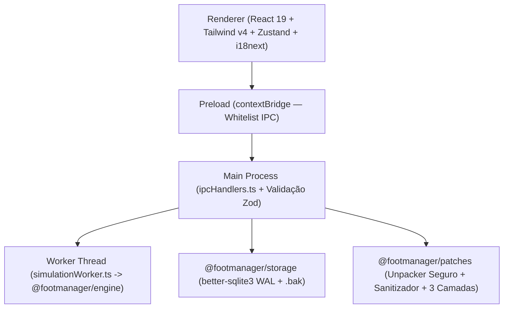

# Arquitetura Técnica — FootManager

> **Última Atualização:** Fase 0 — Fundação (22/11/2026)

## 1. Princípios Arquiteturais

1. **Desacoplamento Absoluto do Motor (`packages/engine`):** todo o núcleo de regras, PRNG determinístico, calendário de 52 semanas, cálculo de setores e curva etária é escrito em TypeScript puro, sem qualquer dependência de React, DOM, Electron ou sistema de arquivos.
2. **Orientação a Dados (`DEC-002` e `DEC-009`):** ligas, copas, clubes, estádios e elencos vivem em `data/core/` usando exatamente o mesmo contrato declarativo dos patches `.fmpack`.
3. **Execução Fora da Thread de UI:** a simulação de avanço semanal roda em uma `Worker Thread` dedicada (`apps/desktop/electron/simulationWorker.ts`), garantindo 60 FPS na interface e tempo de simulação alvo `< 1.000 ms`.
4. **Isolamento por Snapshot (`DEC-011`):** cada carreira salva é um arquivo autocontido `.fmsave` (SQLite WAL), imune a remoções ou alterações futuras de patches.
5. **Preparado para Expansão (`DEC-007` e `DEC-012`):** o schema de save já persiste `humanManagers[]` (pronto para Hotseat na v2) e toda a UI consome `i18next` (`pt-BR` por padrão).

## 2. Diagrama de Camadas e Fronteiras de Segurança

## 3. Hardening e Segurança Implementados na Fase 0

| Vetor | Mitigação Aplicada | Local |
| :--- | :--- | :--- |
| **Execução remota / Node no Renderer** | `contextIsolation: true`, `nodeIntegration: false`, `sandbox: true`, `webSecurity: true`, bloqueio estrito de `will-navigate` por origem/arquivo exato (`isAllowedNavigationUrl`) e `setWindowOpenHandler`. | `apps/desktop/electron/main.ts`, `apps/desktop/electron/security.ts` |
| **Injeção de scripts / `eval`** | Cabeçalho HTTP `Content-Security-Policy` (`default-src 'self'; script-src 'self'; object-src 'none'`) deduplicado + injeção de meta CSP apenas no build de produção. | `apps/desktop/electron/main.ts`, `apps/desktop/electron/security.ts`, `apps/desktop/vite.config.ts` |
| **Abuso de canais IPC** | Whitelist fechada em `IPC_CHANNELS` + validação obrigatória via Zod (`VALIDATION_ERROR` limpo) + `SimulationWorkerBridge` com timeout e rejeição imediata em crash da Worker. | `packages/schemas/src/ipc.schema.ts`, `apps/desktop/electron/ipcHandlers.ts` |
| **SQL Injection** | 100% *prepared statements* parametrizados no `better-sqlite3`; nenhuma concatenação de SQL. | `packages/storage/src/saveRepository.ts`, `historyRepository.ts` |
| **Path Traversal & ZIP Bombs** | Regex estrito em `SaveIdSchema` + contenção via `path.resolve`; bloqueio de `..`, caminhos absolutos, symlinks UNIX, entradas duplicadas e descompactação limitada em RAM (`zlib.inflateRawSync` com `maxOutputLength`). | `packages/storage/src/saveRepository.ts`, `packages/patches/src/unpacker.ts` |
| **XSS via Escudos / UI** | Proibido `dangerouslySetInnerHTML`; tokenizador/sanitizador de SVG por **allowlist estrita** de tags e atributos + validação de assinatura mágica binária para PNG e WebP. | `packages/patches/src/sanitizer.ts`, `packages/patches/src/unpacker.ts` |

## 4. Persistência Atômica SQLite WAL (`packages/storage`)

- Modo `PRAGMA journal_mode = WAL`, `PRAGMA foreign_keys = ON`, `PRAGMA synchronous = NORMAL`.
- Migrações versionadas e idempotentes (`schema_migrations` + `001_initial_schema`).
- Protocolo de gravação segura:
  1. Transação SQLite (`db.transaction`).
  2. Consolidação do WAL (`PRAGMA wal_checkpoint(TRUNCATE)`).
  3. Validação física e lógica (`PRAGMA quick_check === 'ok'`).
  4. Fechamento limpo e rotação atômica para `<saveId>.fmsave.bak` via arquivo temporário `.tmp` + `rename`.
- Recuperação automática: se `<saveId>.fmsave` estiver corrompido ou ausente na leitura, o repositório valida `.fmsave.bak`, limpa arquivos `-wal`/`-shm` órfãos e restaura atomicamente via `.recover.tmp` + `rename`. `listSaves()` também expõe backups `.fmsave.bak` órfãos recuperáveis, e `verifySaveIntegrity()` inspeciona em modo somente leitura sem mutar o banco.

## 5. Tema Dinâmico Acessível (WCAG 2.2)

O módulo `apps/desktop/src/app/theme.ts` recebe a cor primária/secundária validada (`#RRGGBB`) do clube treinado e:
- Calcula luminância relativa sRGB e razão de contraste WCAG.
- Seleciona automaticamente texto branco (`#FFFFFF`) ou escuro (`#09090B`) sobre `--club-primary`.
- Ajusta `--club-accent-text` para garantir razão `>= 4.5:1` sobre `--bg-surface`, `--bg-elevated` (`#1B1B22` escuro / `#F1F5F9` claro) e suas respectivas composições `--club-accent-soft` em Modo Escuro e Modo Claro.

## 6. Auditoria Estática e Qualidade (`npm run lint`)

O script `scripts/lint.mjs` utiliza a API oficial do compilador TypeScript para validar automaticamente:
- Flags `strict`, `noUnusedLocals` e `noUnusedParameters` em `tsconfig.base.json` e ausência de símbolos não utilizados em todos os workspaces.
- Regras de segurança da Seção 11.1 (bloqueio de `dangerouslySetInnerHTML`, `eval`, `new Function`, `.innerHTML`, `shell: true`, interpolação SQL e flags inseguras no Electron).
- Pureza absoluta de `packages/engine/src/` (apenas imports relativos e `@footmanager/schemas`, sem APIs de DOM/Node/Electron/SQLite).
- Modularidade (teto de 50 linhas por função conforme Seção 11.2) e comentários explicativos em português-BR.
